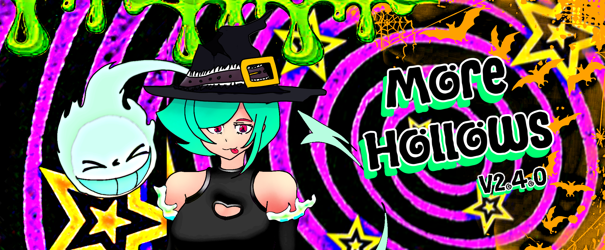

<h1 align="center">Wanna Smile: More Hollows</h1>

<p align="center">
  <strong><em>"a cure to boredom"</em> -smiledemic</strong>
</p>

<p align="center">
  <a href="https://vvannazmile.github.io./">
    
  </a>
  
  
  
  
  <a href="https://ankomstudios.com/fundme/">
    
  </a>
  <a href="https://open.spotify.com/artist/01JJmyvW0JjxC0fpLurTAR?si=sKugLrpKS6mHCvkg6AOwmQ">
    
  </a>
</p>


# V2.3.0

More Hollows is finalized, new profile display system, finished global chat, and now using SQL rather than GS, while also Adding Trails and New loading methods.

### In the Works

WannaSmile is continually evolving as a creative platform. The following features are in development or planned:

- GIF and sticker reactions within the DM system.
- An about:blank opener for displaying external content in a blank tab.
- **SoundScape V2** — An improved music experience with a larger library and lyrics support.

## Tech Stack

Love WannaSmile? Fork it!

WannaSmile is built with the following languages, tools, and platforms. Explore the sources, learn from them, and modify the project to make it your own.

<p align="center">
  
  
  
  
  
  
  
  
  
  
  
  
  
  
  
</p>

# Contributors

These are the contributors to WannaSmile. Check out their profiles and drop them a follow!

<p align="center">
  <a href="https://github.com/vvannazmile/vvannazmile.github.io/graphs/contributors">
    
  </a>
</p>

<p align="center">
  <a href="https://github.com/vvannazmile/vvannazmile.github.io/graphs/contributors">View All Contributors</a>
  &nbsp;·&nbsp;
  <a href="https://github.com/vvannazmile/vvannazmile.github.io/graphs/commit-activity">Commit Activity</a>
</p>

## Getting Started

Visit the live website to explore the project:

 <p align="right">

  <a href="https://vvannazmile.github.io./">
    <strong>Open WannaSmile4Evr →</strong>
  </a>
</p>

To explore or work on the source code, clone the repository:

```bash
git clone https://github.com/vvannazmile/vvannazmile.github.io.git
cd vvannazmile.github.io
```

Open `index.html` in VS Code and use a local development server to test changes. Some features depend on external services and may require configured endpoints and access permissions.

## Repository Structure

| Path | Purpose |
|---|---|
| `assets/` | Images, icons, and other static assets |
| `documentation/` | Project documentation |
| `system/` | Core stylesheets, scripts, and supporting resources |
| `workflows/` | Workflow-related project files |
| `.github/workflows/` | GitHub Actions workflows |
| `index.html` | Main website entry point |
| `data.gs` | Google Apps Script integration |
| `version.json` | Version and update metadata |

---

## Funding & Support

You can support WannaSmile4Evr either by listening to [my music on Spotify](https://open.spotify.com/artist/01JJmyvW0JjxC0fpLurTAR?si=sKugLrpKS6mHCvkg6AOwmQ) or through direct donations to help cover domain costs, hosting, and ongoing development.

<p align="center">
  <a href="https://ankomstudios.com/fundme/">
    <strong>Support WannaSmile4Evr</strong>
  </a>
</p>

---

<p align="center">
WannaSmile4Evr is an evolving project. Features, pages, and integrations may change as development continues.
</p>

<p align="center">
  <a href="https://github.com/vvannazmile">GitHub Profile</a>
  &nbsp;·&nbsp;
  <a href="https://github.com/vvannazmile/vvannazmile.github.io">Source Code</a>
  &nbsp;·&nbsp;
  <a href="https://vvannazmile.github.io./">Live Website</a>
</p>
